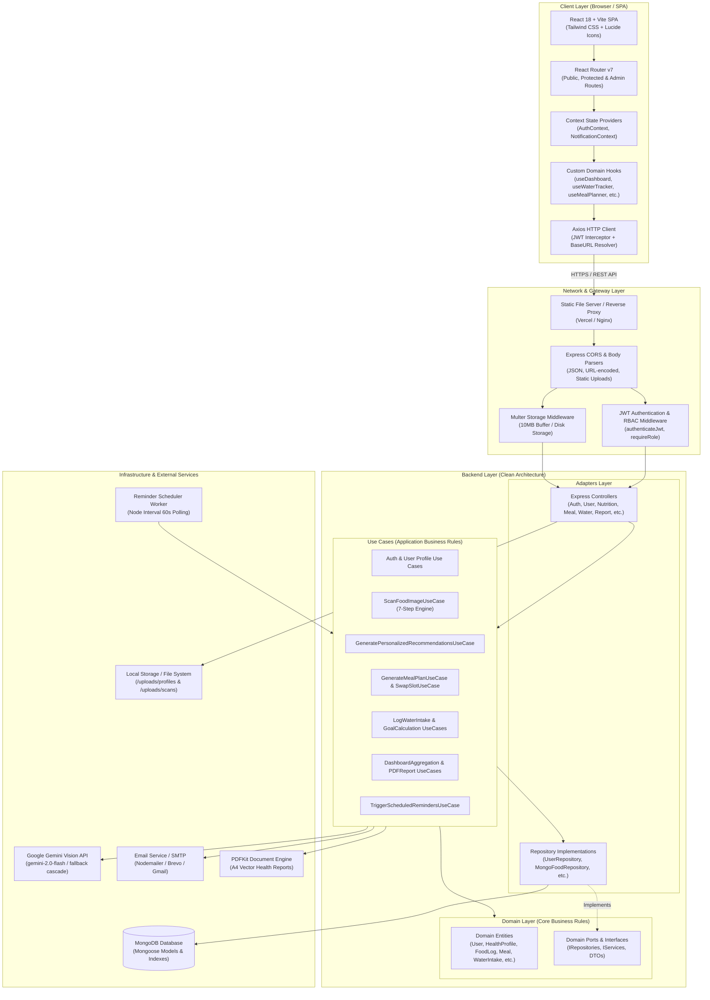
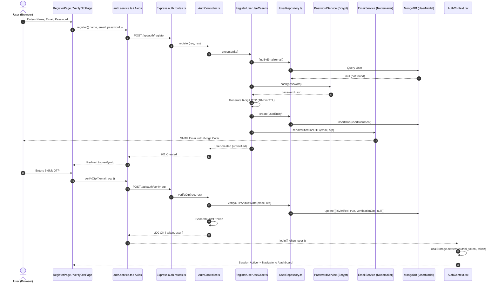
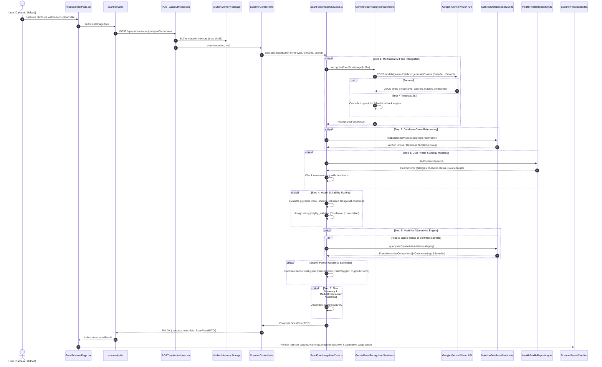
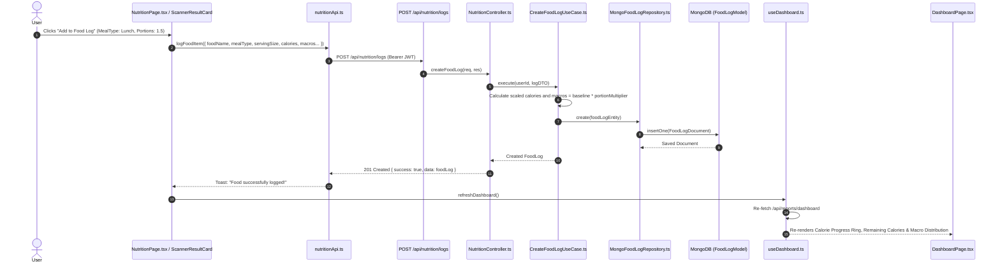
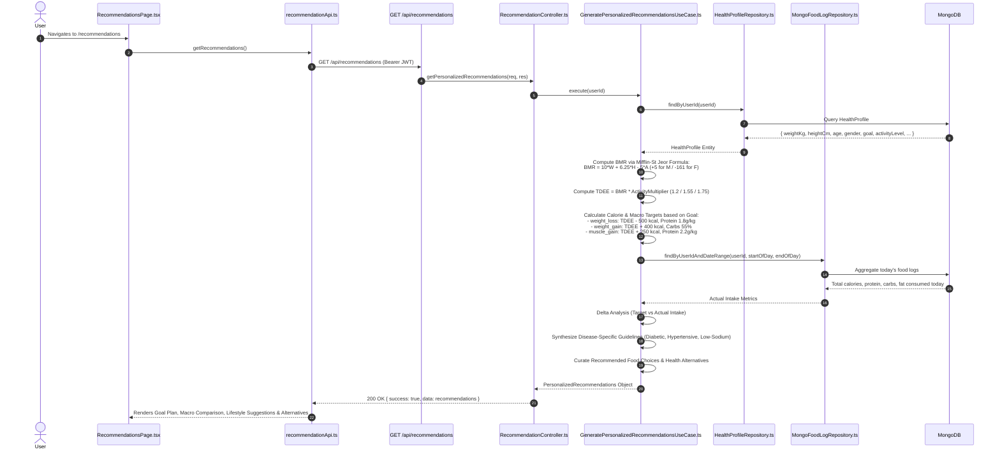
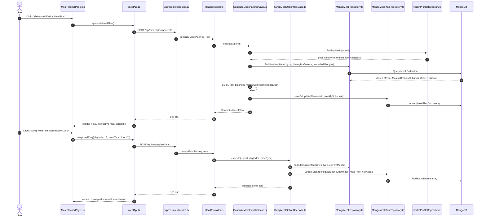
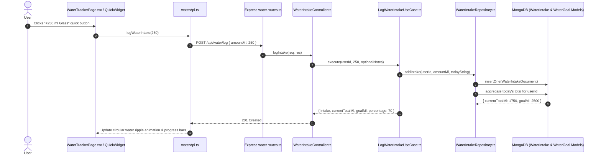
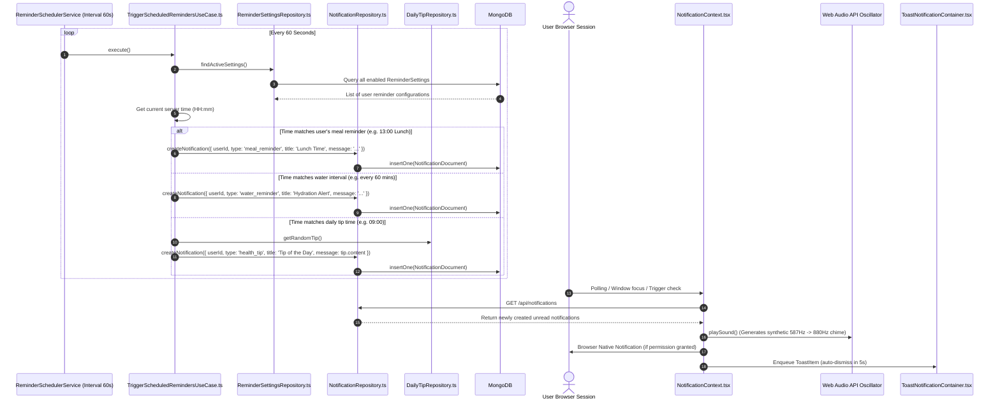
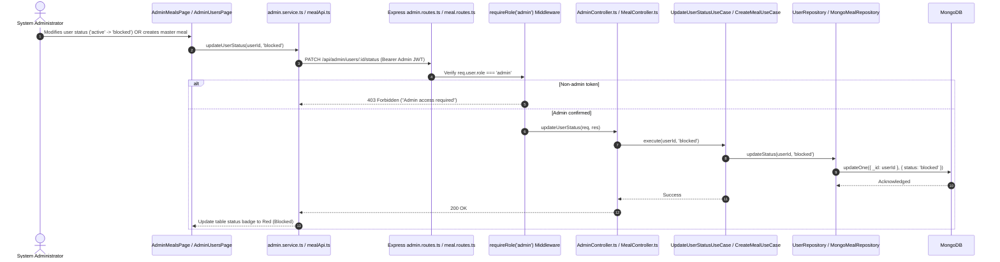

# System Architecture & End-to-End Flow Specification
## AI-Based Personalized Health & Nutrition Management System (NutriAI)

---

## 1. Executive Summary

The **AI-Based Personalized Health & Nutrition Management System (NutriAI)** is a full-stack, enterprise-grade health, dietary tracking, and clinical wellness platform. The system pairs multimodal Artificial Intelligence (Google Gemini Vision) with deterministic clinical nutrition algorithms (Mifflin-St Jeor BMR/TDEE formulation, WHO BMI categorization, glycemic index evaluation, and allergy cross-referencing).

The architecture is divided into two primary subsystems:
1. **Frontend**: A modern Single Page Application (SPA) built with **React 18**, **TypeScript**, **Vite 6**, and **Tailwind CSS**, featuring custom React Hooks, Context-based reactive state, and Chart.js analytical visualizations.
2. **Backend**: An enterprise REST API built with **Node.js**, **Express**, **TypeScript**, and **MongoDB / Mongoose**, engineered strictly around **Clean Architecture (Hexagonal / Ports-and-Adapters)** and **SOLID** principles.

---

## 2. High-Level System Architecture

The following diagram illustrates the complete high-level topology, showing the communication paths between the client browser, API gateways, layered backend components, MongoDB database, and external third-party services.



---

## 3. Backend Clean Architecture Deep-Dive

The backend source code under [`Backend/src`](file:///home/dhyan/Documents/Freelance/AI%20Healt%20Nutrition/Backend/src) is strictly partitioned according to Uncle Bob's Clean Architecture concentric circles. Dependencies point exclusively inwards:

```
┌────────────────────────────────────────────────────────────┐
│ Frameworks & Drivers (Express, Mongoose, Gemini, PDFKit)   │
│  ┌──────────────────────────────────────────────────────┐  │
│  │ Interface Adapters (Controllers, Repositories, DTOs) │  │
│  │  ┌────────────────────────────────────────────────┐  │  │
│  │  │ Use Cases (Application Business Rules)         │  │  │
│  │  │  ┌──────────────────────────────────────────┐  │  │  │
│  │  │  │ Entities & Interfaces (Core Domain)      │  │  │  │
│  │  │  └──────────────────────────────────────────┘  │  │  │
│  │  └────────────────────────────────────────────────┘  │  │
│  └──────────────────────────────────────────────────────┘  │
└────────────────────────────────────────────────────────────┘
```

### 3.1 Domain Layer (`Backend/src/domain/`)
The heart of the application containing zero external dependencies (no Express, no Mongoose):
- **Entities**: Pure TypeScript classes/interfaces modeling core business concepts:
  - [`User`](file:///home/dhyan/Documents/Freelance/AI%20Healt%20Nutrition/Backend/src/domain/entities/User.ts)
  - [`HealthProfile`](file:///home/dhyan/Documents/Freelance/AI%20Healt%20Nutrition/Backend/src/domain/entities/HealthProfile.ts)
  - [`FoodItem`](file:///home/dhyan/Documents/Freelance/AI%20Healt%20Nutrition/Backend/src/domain/entities/FoodItem.ts)
  - [`FoodLog`](file:///home/dhyan/Documents/Freelance/AI%20Healt%20Nutrition/Backend/src/domain/entities/FoodLog.ts)
  - [`Meal`](file:///home/dhyan/Documents/Freelance/AI%20Healt%20Nutrition/Backend/src/domain/entities/Meal.ts)
  - [`Recommendation`](file:///home/dhyan/Documents/Freelance/AI%20Healt%20Nutrition/Backend/src/domain/entities/Recommendation.ts)
  - [`WaterIntake`](file:///home/dhyan/Documents/Freelance/AI%20Healt%20Nutrition/Backend/src/domain/entities/WaterIntake.ts)
  - [`Notification`](file:///home/dhyan/Documents/Freelance/AI%20Healt%20Nutrition/Backend/src/domain/entities/Notification.ts)
  - [`ReminderSettings`](file:///home/dhyan/Documents/Freelance/AI%20Healt%20Nutrition/Backend/src/domain/entities/ReminderSettings.ts)
  - [`WeightBmiLog`](file:///home/dhyan/Documents/Freelance/AI%20Healt%20Nutrition/Backend/src/domain/entities/WeightBmiLog.ts)
  - [`Article`](file:///home/dhyan/Documents/Freelance/AI%20Healt%20Nutrition/Backend/src/domain/entities/Article.ts)
  - [`Faq`](file:///home/dhyan/Documents/Freelance/AI%20Healt%20Nutrition/Backend/src/domain/entities/Faq.ts)
  - [`DailyTip`](file:///home/dhyan/Documents/Freelance/AI%20Healt%20Nutrition/Backend/src/domain/entities/DailyTip.ts)
- **Interfaces (Ports)**:
  - Repository interfaces (`IUserRepository`, `IHealthProfileRepository`, `IFoodRepository`, `IFoodLogRepository`, `IMealRepository`, `IMealPlanRepository`, `IWaterIntakeRepository`, `INotificationRepository`, `IReminderSettingsRepository`, etc.).
  - Service interfaces (`IFoodRecognitionService`, `INutritionDatabaseService`, `IPasswordService`, `IJwtService`, `IEmailService`, `IPdfReportService`).

### 3.2 Use Cases Layer (`Backend/src/useCases/`)
Encapsulates all application workflows, formulas, and validations:
- **Auth**: `RegisterUserUseCase`, `VerifyEmailOTPUseCase`, `LoginUserUseCase`, `ForgotPasswordUseCase`, `ResetPasswordUseCase`, `GetAuthenticatedUserUseCase`.
- **Nutrition & Vision**: `ScanFoodImageUseCase` (7-step AI pipeline), `AnalyzeNutritionUseCase`, `SearchFoodUseCase`, `GetFoodDetailsUseCase`.
- **Recommendations**: `GeneratePersonalizedRecommendationsUseCase`, `GetFoodAlternativesUseCase`.
- **Meals**: `GenerateMealPlanUseCase`, `GetUserMealPlanUseCase`, `SwapMealOptionUseCase`, `CreateMealUseCase`, `UpdateMealUseCase`, `DeleteMealUseCase`.
- **Water**: `LogWaterIntakeUseCase`, `GetWaterSummaryUseCase`, `UpdateWaterGoalUseCase`, `GetWaterHistoryUseCase`, `DeleteWaterIntakeUseCase`.
- **Reports & Dashboard**: `GetUserDashboardUseCase`, `GetDailyReportUseCase`, `GetWeeklyReportUseCase`, `GetMonthlyReportUseCase`, `GetHealthTrendsUseCase`, `LogWeightBmiUseCase`, `GeneratePdfReportUseCase`.
- **Reminders**: `TriggerScheduledRemindersUseCase`, `GetReminderSettingsUseCase`, `UpdateReminderSettingsUseCase`, `GetDailyHealthTipUseCase`.
- **User & Admin**: `GetHealthProfileUseCase`, `UpdateHealthProfileUseCase`, `UploadProfilePictureUseCase`, `AdminLoginUseCase`, `GetAllUsersUseCase`, `UpdateUserStatusUseCase`, `DeleteUserUseCase`.

### 3.3 Adapters Layer (`Backend/src/adapters/`)
Translates data between external formats (HTTP/Express requests, MongoDB docs) and internal Domain Use Cases:
- **Controllers**: Thin controllers that parse HTTP params/body, execute use cases, and format JSON responses (`AuthController`, `HealthProfileController`, `NutritionController`, `ScannerController`, `MealController`, `WaterIntakeController`, `ReportController`, `ReminderController`, `NotificationController`, `EducationController`, `AdminController`).
- **Repositories**: Mongoose-based data access implementations fulfilling the domain interfaces (`UserRepository`, `HealthProfileRepository`, `MongoFoodRepository`, `MongoFoodLogRepository`, `MongoMealRepository`, `MongoMealPlanRepository`, `WaterIntakeRepository`, `NotificationRepository`, `ReminderSettingsRepository`, `WeightBmiLogRepository`, `ArticleRepository`, `FaqRepository`, `DailyTipRepository`).
- **Middlewares**: `authenticateJwt`, `requireRole('admin')`, `profileUpload` (Multer), and `globalErrorHandler`.

### 3.4 Frameworks & Drivers Layer (`Backend/src/framework/`)
Connects to concrete technology implementations:
- **Database**: `connection.ts` (Mongoose connection pool), Mongoose Schema definitions (`UserModel`, `HealthProfileModel`, etc.), and automatic database seeders (`seedAdmin`, `seedMeals`, `seedDailyTips`, `seedEducation`).
- **Services**:
  - `ai/GeminiFoodRecognitionService.ts`: Direct Google Gemini REST API integration using base64 payload transfer with multi-model failover.
  - `pdf/PdfReportService.ts`: Vector PDF synthesis using PDFKit.
  - `email/EmailService.ts`: Nodemailer SMTP transporter for OTP and password resets.
  - `password/PasswordService.ts`: Bcrypt wrapper for cryptographic hashing and salt generation.
  - `jwt/JwtService.ts`: JsonWebToken signing and decoding.
  - `reminderScheduler.ts`: Singleton background cron runner that triggers scheduled reminder checks every 60 seconds.
- **Routes**: Modular Express routers mounted into [`app.ts`](file:///home/dhyan/Documents/Freelance/AI%20Healt%20Nutrition/Backend/src/app.ts).

---

## 4. Frontend Architecture & Component Hierarchy

The frontend is structured around feature-based separation and reactive state synchronization:

```
Frontend/src/
├── components/          # Reusable presentation components
│   ├── admin/           # Admin modals (DeleteConfirm, UserProfile)
│   ├── common/          # ToastNotificationContainer, StatusBadge
│   ├── dashboard/       # CalorieCard, WaterCard, BmiStatus, HealthScore, etc.
│   ├── education/       # Admin article/FAQ modals
│   ├── layout/          # Navbar, AdminLayout, NotificationCenter
│   ├── meals/           # DailyMealCard, WeeklyPlanSchedule, MealDetailModal
│   ├── notifications/   # Reminder cards & DailyTipBanner
│   ├── nutrition/       # FoodLogHistoryList, SearchInput, NutritionAnalysisCard
│   ├── profile/         # BMICard, HealthProfileForm, PictureUploader
│   ├── recommendations/ # GoalPlanCard, FoodAlternativesCard, PortionGuidanceCard
│   └── water/           # WaterProgressWidget, HistoryTable, ReminderSettings
├── context/             # React Context Providers
│   ├── AuthContext.tsx         # User authentication, token lifecycle & session
│   └── NotificationContext.tsx # In-app notifications, browser notifications, sound synthesis
├── features/            # Complex multi-component feature domains
│   ├── reports/components/     # Daily/Weekly/Monthly report views & Chart.js components
│   └── scanner/components/     # CameraCaptureModal & ScannerResultCard
├── hooks/               # Domain Custom Hooks (encapsulating React state & API calls)
│   ├── useDashboard.ts         # Central health score & daily log coordinator
│   ├── useWaterTracker.ts      # Hydration calculations, quick additions, goal sync
│   ├── useMealPlanner.ts       # Meal plan fetching, generation, and slot swapping
│   ├── useRecommendations.ts  # Clinical diet & alternative suggestions
│   ├── useReminders.ts        # Timers, settings, and health tip triggers
│   ├── useHealthReports.ts    # Trend data aggregation & PDF download trigger
│   ├── useEducation.ts        # Articles, search, filter & FAQ accordion state
│   └── useAdminMeals.ts       # Master meal catalog CRUD operations
├── pages/               # Routed View Components
│   ├── admin/           # AdminLoginPage, AdminUsersPage, AdminMealsPage, AdminEducationPage
│   ├── auth/            # LoginPage, RegisterPage, VerifyOtpPage, ForgotPasswordPage
│   ├── meals/           # MealPlannerPage
│   ├── notifications/   # SmartNotificationsPage
│   ├── nutrition/       # NutritionPage
│   ├── profile/         # HealthProfilePageLayout with Personal, BMI, Medical, Lifestyle tabs
│   ├── recommendations/ # RecommendationsPage
│   ├── reports/         # HealthReportsPage
│   ├── scanner/         # FoodScannerPage
│   └── water/           # WaterTrackerPage
├── routes/              # Route Guards
│   ├── PublicRoute.tsx         # Restricts authenticated users from guest pages
│   ├── ProtectedRoute.tsx      # Requires valid JWT session
│   └── AdminRoute.tsx          # Requires authenticated user with role === 'admin'
└── services/            # Axios API Service Wrappers
    ├── api.ts                  # Axios instance with Bearer token injection
    ├── auth.service.ts
    ├── scannerApi.ts
    ├── nutritionApi.ts
    ├── mealApi.ts
    ├── waterApi.ts
    ├── recommendationApi.ts
    ├── reminderApi.ts
    ├── reportApi.ts
    ├── educationApi.ts
    ├── healthProfile.service.ts
    └── admin.service.ts
```

---

## 5. Detailed End-to-End System Flows

### Flow 1: User Registration, OTP Verification, Login & Session Management



---

### Flow 2: AI Food Scanner & Computer Vision Multimodal Pipeline

This is the system's flagship AI pipeline. It executes a comprehensive 7-step clinical and nutritional evaluation upon receiving an image.



---

### Flow 3: Nutrition Logging, Daily Caloric & Macro Calculation



---

### Flow 4: Personalized Recommendation Engine (Mifflin-St Jeor Clinical Logic)



---

### Flow 5: Intelligent Meal Planning & Automated Meal Slot Swapping



---

### Flow 6: Hydration Tracking & Water Goal Calculation



---

### Flow 7: Smart Notification & Background Worker Reminder Cycle



---

### Flow 8: Health Analytics, Weight Progression & PDF Report Generation

```mermaid
sequenceDiagram
    autonumber
    actor User as User
    participant ReportsPage as HealthReportsPage.tsx
    participant ReportApi as reportApi.ts
    participant ReportRoutes as Express report.routes.ts
    participant ReportCtrl as ReportController.ts
    participant PdfUC as GeneratePdfReportUseCase.ts
    participant DailyUC as GetDailyReportUseCase.ts
    participant WeeklyUC as GetWeeklyReportUseCase.ts
    participant MonthlyUC as GetMonthlyReportUseCase.ts
    participant PdfEngine as PdfReportService.ts (PDFKit)
    participant UserRepo as UserRepository.ts

    User->>ReportsPage: Clicks "Download Clinical PDF Report" (Period: 'weekly')
    ReportsPage->>ReportApi: downloadPdfReport('weekly')
    ReportApi->>ReportRoutes: GET /api/reports/download-pdf?period=weekly
    ReportRoutes->>ReportCtrl: downloadPdfReport(req, res)
    ReportCtrl->>PdfUC: execute(userId, 'weekly')

    PdfUC->>UserRepo: findById(userId)
    PdfUC->>WeeklyUC: execute(userId)
    WeeklyUC->>WeeklyUC: Aggregate 7-day calories, water, macro averages & weight delta
    WeeklyUC-->>PdfUC: Consolidated Report Data

    PdfUC->>PdfEngine: generateReportBuffer(pdfReportData)
    PdfEngine->>PdfEngine: Build vector document:<br/>- Branded header banner & logo<br/>- Patient info & BMI category badge<br/>- Calorie & Water intake summary table<br/>- Macro ratio pie breakdown<br/>- Detailed daily breakdown logs<br/>- Clinical health disclaimers
    PdfEngine-->>PdfUC: Binary PDF Buffer
    PdfUC-->>ReportCtrl: PDF Buffer
    ReportCtrl->>ReportCtrl: Set headers: Content-Type: application/pdf,<br/>Content-Disposition: attachment; filename=nutriai-report.pdf
    ReportCtrl-->>ReportApi: Stream binary octet-stream
    ReportApi-->>User: Browser prompts file download: "nutriai-weekly-health-report.pdf"
```

---

### Flow 9: Admin Backoffice & System Operations



---

## 6. Complete Database Schema & Entity-Relationship Diagram (ERD)

The MongoDB database contains 14 specialized collections defined with Mongoose schemas in [`Backend/src/framework/database/models/`](file:///home/dhyan/Documents/Freelance/AI%20Healt%20Nutrition/Backend/src/framework/database/models/).

```mermaid
erDiagram
    User ||--|| HealthProfile : "has profile"
    User ||--o{ FoodLog : "logs meals"
    User ||--o| MealPlan : "follows plan"
    User ||--o{ WaterIntake : "records hydration"
    User ||--o| WaterGoal : "configures goal"
    User ||--o{ WeightBmiLog : "tracks weight history"
    User ||--o| ReminderSettings : "configures alerts"
    User ||--o{ Notification : "receives alerts"
    
    FoodItem ||--o{ FoodLog : "referenced in log"
    Meal ||--o{ MealPlan : "composed into slots"
    
    Article }o--|| User : "authored by admin"
    Faq }o--|| User : "authored by admin"
    DailyTip }o--|| User : "authored by admin"

    User {
        ObjectId _id PK
        string name
        string email UK
        string passwordHash
        string role "user | admin"
        boolean isVerified
        string verificationOtp
        date otpExpiresAt
        string resetPasswordOtp
        date resetPasswordExpiresAt
        string status "active | blocked"
        string profilePicture
        date createdAt
        date updatedAt
    }

    HealthProfile {
        ObjectId _id PK
        ObjectId userId FK,UK
        number age
        string gender "male | female | other"
        number heightCm
        number weightKg
        string bloodGroup
        number bmi
        string bmiCategory "Underweight | Normal | Overweight | Obese"
        string goal "weight_loss | weight_gain | muscle_gain | maintenance"
        stringArray foodAllergies
        stringArray medicalHistory
        string activityLevel "sedentary | moderate | active"
        number sleepHours
        string dietaryPreference
        boolean hasDiabetes
        string diabetesStatus
        date createdAt
        date updatedAt
    }

    FoodItem {
        ObjectId _id PK
        string name UK
        string category
        number calories
        number protein
        number carbohydrates
        number fat
        number fiber
        number sugar
        number sodium
        number servingSize
        string servingUnit
        stringArray allergens
        stringArray dietaryTags
        boolean isVerified
    }

    FoodLog {
        ObjectId _id PK
        ObjectId userId FK
        ObjectId foodItemId FK
        string foodName
        string mealType "breakfast | lunch | dinner | snack"
        number servingSize
        string servingUnit
        number calories
        number protein
        number carbohydrates
        number fat
        number fiber
        number sugar
        number sodium
        array vitaminsAndMinerals
        date loggedAt
    }

    Meal {
        ObjectId _id PK
        string name
        string mealType "breakfast | lunch | dinner | snack"
        string category
        string dietaryPreference "Vegetarian | Non-Vegetarian | Vegan | Keto | Pescatarian"
        stringArray suitableGoals
        stringArray allergens
        number calories
        number protein
        number carbohydrates
        number fat
        number fiber
        number servingSize
        string servingUnit
        stringArray ingredients
        string instructions
        string imageUrl
        boolean isVerified
    }

    MealPlan {
        ObjectId _id PK
        ObjectId userId FK,UK
        string startDate
        string goal
        string dietaryPreference
        stringArray excludedAllergies
        mixed weeklySchedule
        date generatedAt
    }

    WaterIntake {
        ObjectId _id PK
        ObjectId userId FK
        number amountMl
        string date "YYYY-MM-DD"
        date timestamp
        string notes
    }

    WaterGoal {
        ObjectId _id PK
        ObjectId userId FK,UK
        number dailyGoalMl
        date updatedAt
    }

    WeightBmiLog {
        ObjectId _id PK
        ObjectId userId FK
        number weightKg
        number heightCm
        number bmi
        string bmiCategory
        string date "YYYY-MM-DD"
        date recordedAt
    }

    ReminderSettings {
        ObjectId _id PK
        ObjectId userId FK,UK
        object meals
        object water
        object exercise
        object sleep
        object dailyTip
        boolean browserNotificationsEnabled
        boolean soundEnabled
    }

    Notification {
        ObjectId _id PK
        ObjectId userId FK
        string title
        string message
        string type "water_reminder | meal_reminder | exercise_reminder | sleep_reminder | health_tip | health_alert | system"
        boolean isRead
        string actionUrl
        date createdAt
    }

    Article {
        ObjectId _id PK
        string title
        string slug UK
        string category
        string summary
        string content
        string imageUrl
        number readTimeMinutes
        stringArray tags
        boolean isPublished
    }

    Faq {
        ObjectId _id PK
        string question
        string answer
        string category
        number order
        boolean isPublished
    }

    DailyTip {
        ObjectId _id PK
        string title
        string content
        string category
        boolean isActive
    }
```



---

## 7. REST API Route Catalog & Endpoint Specifications

All endpoints are prefixed with `/api` unless specified otherwise:

| Route Path | HTTP Verb | Auth Required | Role | Controller Action | Description |
| :--- | :---: | :---: | :---: | :--- | :--- |
| **System & Health** | | | | | |
| `/health`, `/ping` | `GET` | No | Public | `healthController.check` | Keep-alive and uptime monitoring |
| **Authentication** | | | | | |
| `/api/auth/register` | `POST` | No | Public | `authController.register` | Register user & dispatch 6-digit OTP email |
| `/api/auth/verify-otp` | `POST` | No | Public | `authController.verifyOtp` | Verify OTP code & activate account |
| `/api/auth/resend-otp` | `POST` | No | Public | `authController.resendOtp` | Issue new OTP code |
| `/api/auth/login` | `POST` | No | Public | `authController.login` | Authenticate credentials & return JWT |
| `/api/auth/forgot-password` | `POST` | No | Public | `authController.forgotPassword` | Issue password reset email |
| `/api/auth/reset-password` | `POST` | No | Public | `authController.resetPassword` | Change password with valid OTP code |
| `/api/auth/me` | `GET` | Yes | Any | `authController.getMe` | Return current authenticated user profile |
| **Health Profile** | | | | | |
| `/api/user/profile` | `GET` | Yes | Any | `healthProfileController.getProfile` | Get comprehensive health & biometric data |
| `/api/user/profile` | `PUT` | Yes | Any | `healthProfileController.updateProfile`| Update biometric parameters, BMI, goals |
| `/api/user/profile/picture` | `POST` | Yes | Any | `healthProfileController.uploadPicture`| Upload avatar via Multer |
| **Nutrition & AI Scanner** | | | | | |
| `/api/nutrition/scan` | `POST` | Yes | Any | `scannerController.scanImage` | 7-Step Multimodal Gemini AI Vision Analysis |
| `/api/nutrition/search` | `GET` | Yes | Any | `nutritionController.searchFoods` | Query USDA / database foods by keyword |
| `/api/nutrition/food/:id` | `GET` | Yes | Any | `nutritionController.getFoodDetails` | Retrieve detailed nutrient micronutrients |
| `/api/nutrition/analyze` | `POST` | Yes | Any | `nutritionController.analyzeNutrition` | Calculate scaled nutrition for portion |
| `/api/nutrition/logs` | `POST` | Yes | Any | `nutritionController.createFoodLog` | Record daily meal intake log |
| `/api/nutrition/logs` | `GET` | Yes | Any | `nutritionController.getUserFoodLogs` | Retrieve food logs for date range |
| `/api/nutrition/logs/:id` | `DELETE` | Yes | Any | `nutritionController.deleteFoodLog` | Remove logged meal entry |
| **Recommendations** | | | | | |
| `/api/recommendations` | `GET` | Yes | Any | `recommendationController.getRecommendations` | Generate personalized dietary advice & TDEE |
| `/api/recommendations/alternatives` | `POST` | Yes | Any | `recommendationController.getAlternatives` | Retrieve healthier food substitutes |
| **Meal Planning** | | | | | |
| `/api/meals/plan` | `GET` | Yes | Any | `mealController.getUserMealPlan` | Retrieve current user weekly meal schedule |
| `/api/meals/plan/generate` | `POST` | Yes | Any | `mealController.generateMealPlan` | Generate fresh 7-day personalized plan |
| `/api/meals/plan/swap` | `POST` | Yes | Any | `mealController.swapMealSlot` | Swap meal in specific slot with alternative |
| `/api/meals` | `GET` | Yes | Any | `mealController.getAllMeals` | Search master meal catalog |
| `/api/meals` | `POST` | Yes | Admin | `mealController.createMeal` | Admin create master recipe item |
| `/api/meals/:id` | `PUT` | Yes | Admin | `mealController.updateMeal` | Admin update master recipe item |
| `/api/meals/:id` | `DELETE` | Yes | Admin | `mealController.deleteMeal` | Admin delete master recipe item |
| **Water Tracking** | | | | | |
| `/api/water/summary` | `GET` | Yes | Any | `waterIntakeController.getTodaySummary` | Today's intake, goal, and progress percent |
| `/api/water/log` | `POST` | Yes | Any | `waterIntakeController.logIntake` | Add water entry in milliliters |
| `/api/water/log/:intakeId`| `DELETE` | Yes | Any | `waterIntakeController.deleteIntake` | Delete specific water intake entry |
| `/api/water/goal` | `PUT` | Yes | Any | `waterIntakeController.updateGoal` | Set custom daily hydration goal (ml) |
| `/api/water/history` | `GET` | Yes | Any | `waterIntakeController.getHistory` | Query historical hydration by date range |
| **Smart Notifications & Reminders** | | | | | |
| `/api/reminders/settings` | `GET` | Yes | Any | `reminderController.getSettings` | Get scheduled reminder configurations |
| `/api/reminders/settings` | `PUT` | Yes | Any | `reminderController.updateSettings` | Update meal, water, sleep schedules |
| `/api/reminders/tip/daily`| `GET` | Yes | Any | `reminderController.getDailyTip` | Retrieve cached tip of the day |
| `/api/reminders/trigger-check`| `POST` | Yes | Any | `reminderController.triggerCheck` | Force evaluation of user reminder triggers |
| `/api/notifications` | `GET` | Yes | Any | `notificationController.getNotifications` | Fetch in-app notifications |
| `/api/notifications/read-all`| `PATCH` | Yes | Any | `notificationController.markAllAsRead` | Bulk acknowledge all notifications |
| `/api/notifications/:id/read`| `PATCH` | Yes | Any | `notificationController.markAsRead` | Mark single notification as read |
| `/api/notifications/:id` | `DELETE` | Yes | Any | `notificationController.deleteNotification` | Delete notification item |
| **Health Reports & Analytics** | | | | | |
| `/api/reports/dashboard` | `GET` | Yes | Any | `reportController.getDashboard` | Main dashboard summary & health score |
| `/api/reports/daily` | `GET` | Yes | Any | `reportController.getDailyReport` | 24-hour nutrition & water summary |
| `/api/reports/weekly` | `GET` | Yes | Any | `reportController.getWeeklyReport` | 7-day intake rolling averages |
| `/api/reports/monthly` | `GET` | Yes | Any | `reportController.getMonthlyReport` | 30-day comprehensive analytics |
| `/api/reports/trends` | `GET` | Yes | Any | `reportController.getTrends` | Historical macro & caloric trend points |
| `/api/reports/weight-bmi` | `POST` | Yes | Any | `reportController.logWeightBmi` | Log weight entry & compute BMI trajectory |
| `/api/reports/download-pdf`| `GET` | Yes | Any | `reportController.downloadPdfReport` | Stream generated PDF report |
| **Health Education & FAQ** | | | | | |
| `/api/education/articles` | `GET` | No | Public | `educationController.getArticles` | Retrieve published wellness articles |
| `/api/education/articles/:id`| `GET` | No | Public | `educationController.getArticleById` | Read full article by ID or slug |
| `/api/education/faqs` | `GET` | No | Public | `educationController.getFaqs` | Retrieve categorized health FAQs |
| `/api/education/admin/articles`| `POST`/`PUT`/`DELETE` | Yes | Admin | `educationController.*` | Admin article CMS operations |
| `/api/education/admin/faqs` | `POST`/`PUT`/`DELETE` | Yes | Admin | `educationController.*` | Admin FAQ CMS operations |
| **Admin Governance** | | | | | |
| `/api/admin/login` | `POST` | No | Public | `adminController.login` | Admin dedicated authentication |
| `/api/admin/users` | `GET` | Yes | Admin | `adminController.getAllUsers` | Paginated user management directory |
| `/api/admin/users/:id` | `GET` | Yes | Admin | `adminController.getUserProfile` | Deep inspection of user biometric profile |
| `/api/admin/users/:id/status`| `PATCH`| Yes | Admin | `adminController.updateUserStatus` | Block or reactivate user account |
| `/api/admin/users/:id` | `DELETE`| Yes | Admin | `adminController.deleteUser` | Hard delete user and cascade dependencies |

---

## 8. Security, Resiliency & Production Best Practices

### 8.1 Authentication & Authorization Matrix
1. **Stateless JWT Tokens**: Tokens are signed using `HS256` with a configurable expiration (`JWT_EXPIRES_IN=7d`). Payloads contain `{ id, email, role }`.
2. **Bearer Token Injection**: Handled transparently by Axios request interceptors on the client (`Frontend/src/services/api.ts`).
3. **Role-Based Access Control (RBAC)**: Enforced via `requireRole('admin')` middleware. Admin endpoints reject standard `user` tokens with `403 Forbidden`.
4. **Password Cryptography**: Passwords undergo Bcrypt hashing with a minimum of 10 salt rounds. Plaintext passwords are never persisted or logged.

### 8.2 AI Engine High Availability & Fallback Strategy
To guarantee that the user experience is never blocked by third-party AI rate limits or network degradation, [`GeminiFoodRecognitionService`](file:///home/dhyan/Documents/Freelance/AI%20Healt%20Nutrition/Backend/src/framework/services/ai/GeminiFoodRecognitionService.ts) implements:
- **12-Second Per-Model Timeout**: Uses `AbortController` to terminate lagging HTTP requests.
- **Model Cascade**: Sequentially attempts:
  1. `gemini-flash-latest`
  2. `gemini-2.0-flash`
  3. `gemini-1.5-flash-latest`
  4. `gemini-2.5-flash-image`
- **Zero-Block Fallback Estimation**: If all remote API requests fail or the API key is missing, the service falls back to a nutritional estimation model, ensuring that the scanner UI never hangs indefinitely in a loading state.

### 8.3 Input Validation & Centralized Error Handling
1. **Zod & Custom DTO Validators**: Validates request parameters (emails, password complexities, numeric ranges for weight and height) before execution reaches the Use Cases.
2. **AppError Hierarchy**: Operational errors extend the [`AppError`](file:///home/dhyan/Documents/Freelance/AI%20Healt%20Nutrition/Backend/src/shared/errors/AppError.ts) base class with appropriate HTTP status codes (400, 401, 403, 404, 409).
3. **Global Error Middleware**: Unhandled exceptions are intercepted by [`globalErrorHandler`](file:///home/dhyan/Documents/Freelance/AI%20Healt%20Nutrition/Backend/src/adapters/middlewares/error.middleware.ts), sanitizing stack traces in production (`NODE_ENV === 'production'`) and formatting standard JSON error structures.

---

## 9. Summary

This document captures the end-to-end architecture of the **AI-Based Personalized Health & Nutrition Management System**. By decoupling UI concerns (React/Tailwind) from domain business logic (Clean Architecture Use Cases) and abstracting infrastructure components (MongoDB, Google Gemini, PDFKit, Nodemailer), the codebase maintains high maintainability, testability, and operational resilience.
